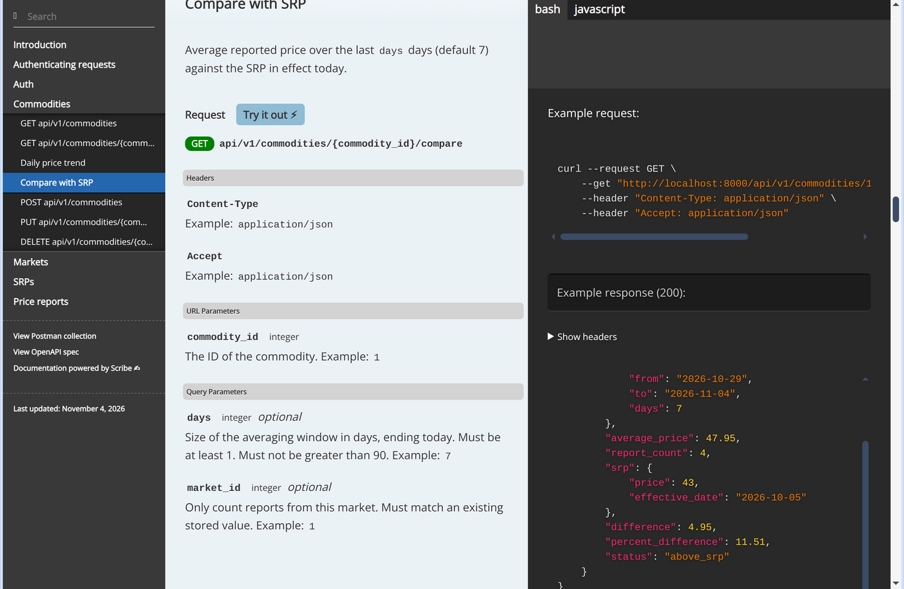

# Bantay Presyo API

REST API for monitoring market prices of basic goods in the Philippines. Users report the prices they see at public markets, and the API compares them with the DTI suggested retail price (SRP) in effect.



## Stack

- PHP 8.3, Laravel 12
- PostgreSQL 16
- Laravel Sanctum (token auth)
- Pest, Laravel Pint, PHPStan (Larastan)
- Scribe for API docs

## Setup

### With Docker

```bash
docker compose up --build
```

This starts PostgreSQL and the app on <http://localhost:8000>. On first run it copies `.env.example` to `.env`, generates an app key, runs migrations, seeds sample data and builds the docs.

### Without Docker

Requires PHP 8.3 with `pdo_pgsql`, Composer, and a PostgreSQL 16 server. You can start only the database with `docker compose up -d db`.

```bash
composer install
cp .env.example .env
php artisan key:generate
php artisan migrate --seed
php artisan scribe:generate
php artisan serve
```

## Environment variables

| Variable | Default | Notes |
| --- | --- | --- |
| `APP_KEY` | empty | Set by `php artisan key:generate` |
| `APP_URL` | `http://localhost:8000` | Used as the base URL in the docs |
| `DB_CONNECTION` | `pgsql` | |
| `DB_HOST` | `127.0.0.1` | `db` inside Docker Compose |
| `DB_PORT` | `5432` | |
| `DB_DATABASE` | `bantay_presyo` | |
| `DB_USERNAME` | `bantay` | |
| `DB_PASSWORD` | `secret` | |

See `.env.example` for the full list.

## Sample data

`php artisan db:seed` creates 13 commodities, 8 markets, two SRP bulletins per commodity and 30 days of price reports. The prices are made up for local testing and are not an official DTI bulletin.

| Email | Password | Role |
| --- | --- | --- |
| `admin@bantaypresyo.test` | `password` | admin |
| `reporter@bantaypresyo.test` | `password` | reporter |

## API

Base path: `/api/v1`. Docs are at <http://localhost:8000/docs>, with the OpenAPI spec at `/docs.openapi` and a Postman collection at `/docs.postman`.

| Method | Path | Auth |
| --- | --- | --- |
| `POST` | `/auth/register` | |
| `POST` | `/auth/login` | |
| `POST` | `/auth/logout` | token |
| `GET` | `/commodities?category=&q=` | |
| `GET` | `/commodities/{id}` | |
| `GET` | `/commodities/{id}/trend?from=&to=&market_id=` | |
| `GET` | `/commodities/{id}/compare?days=&market_id=` | |
| `POST`, `PUT`, `DELETE` | `/commodities`, `/commodities/{id}` | admin |
| `GET` | `/markets?city=&region=`, `/markets/{id}` | |
| `POST`, `PUT`, `DELETE` | `/markets`, `/markets/{id}` | admin |
| `GET` | `/srps?commodity_id=` | |
| `POST`, `DELETE` | `/srps`, `/srps/{id}` | admin |
| `GET` | `/price-reports?commodity_id=&market_id=&from=&to=` | |
| `POST` | `/price-reports` | token |

### Responses

Success:

```json
{ "data": { "id": 1, "name": "Well-milled rice", "category": "Rice", "unit": "kg" } }
```

Lists add `meta` and accept `?page=` and `?per_page=` (default 20, max 100):

```json
{ "data": [], "meta": { "page": 1, "per_page": 20, "total": 13 } }
```

Errors:

```json
{ "error": { "code": "validation_failed", "message": "The given data was invalid.", "details": { "price": ["The price field must be greater than 0."] } } }
```

Timestamps are ISO 8601 in UTC.

### Trend and SRP comparison

`/trend` returns the average, minimum and maximum reported price per day. It covers the last 30 days by default, and a range can be at most 366 days.

`/compare` averages the reports from the last `days` days (default 7, including today) and compares that average with the latest SRP whose `effective_date` is on or before today:

```
difference         = average_price - srp
percent_difference = (average_price - srp) / srp * 100
```

Both values are rounded to 2 decimals. `status` is `above_srp`, `below_srp` or `at_srp`. If there is no SRP or there are no reports, these fields are `null`.

### Example

```bash
TOKEN=$(curl -s -X POST localhost:8000/api/v1/auth/login \
  -H 'Content-Type: application/json' \
  -d '{"email":"reporter@bantaypresyo.test","password":"password"}' | jq -r .data.token)

curl -s -X POST localhost:8000/api/v1/price-reports \
  -H "Authorization: Bearer $TOKEN" -H 'Content-Type: application/json' \
  -d '{"commodity_id":1,"market_id":1,"price":48.50}'

curl -s localhost:8000/api/v1/commodities/1/compare
```

## Tests

The tests run against PostgreSQL, using the `bantay_presyo_test` database. Docker Compose creates it when the database volume is first initialized.

```bash
docker compose up -d db
vendor/bin/pest
```

Lint and static analysis:

```bash
vendor/bin/pint --test
vendor/bin/phpstan analyse
```

CI runs all three on every push and pull request.

## License

MIT
